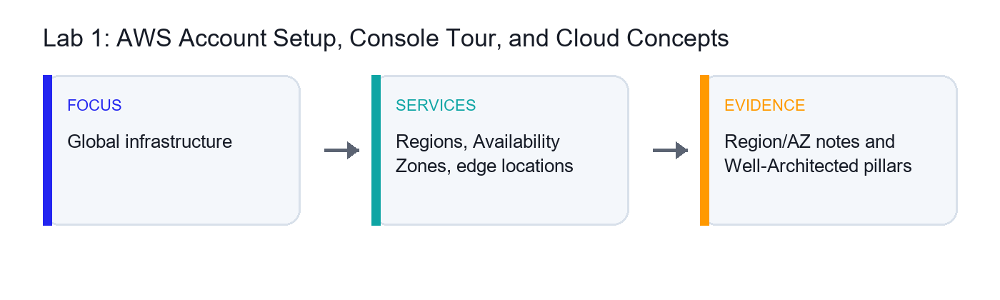
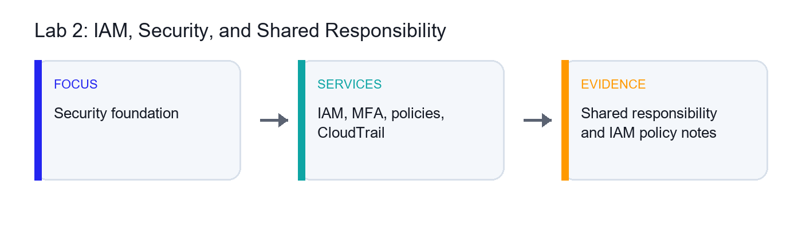
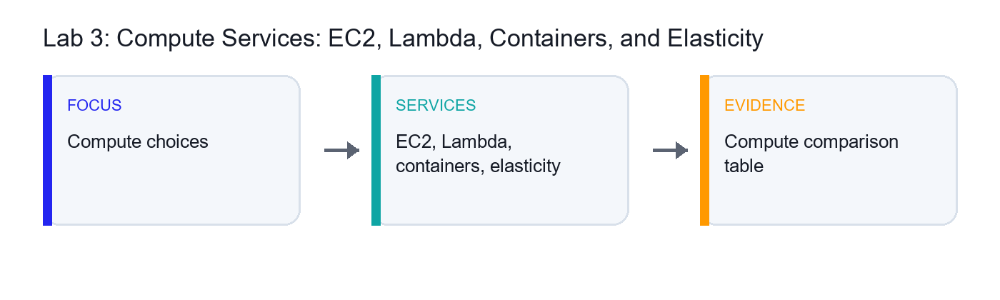
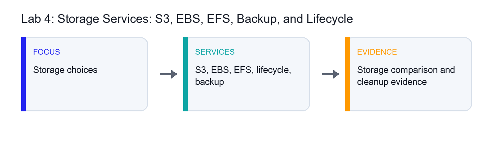
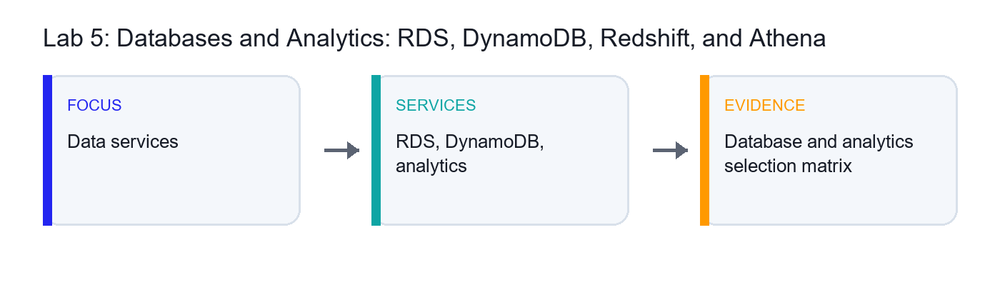
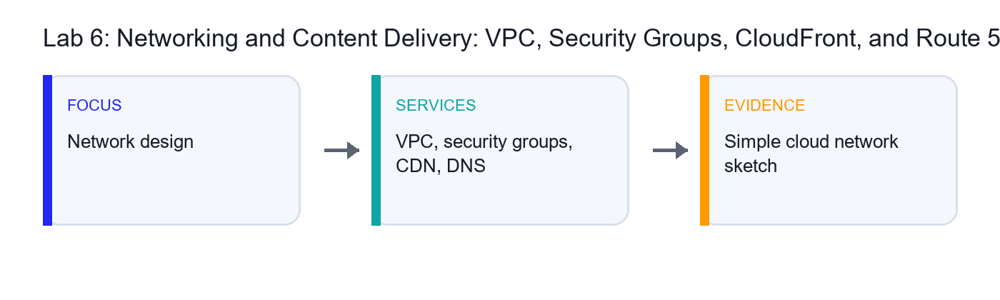
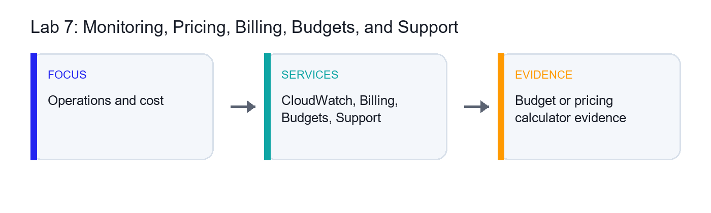
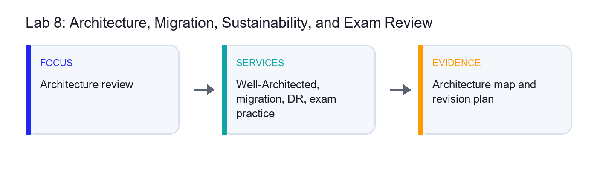

# Learner Guide - AWS Certified Cloud Practitioner Training

Course Code: TGS-2023039183
Registration: https://www.tertiarycourses.com.sg/wsq-aws-certified-cloud-practitioner-training.html

## Recommended Setup

1. Use a trainer-provided AWS account where available.
2. If using your own account, enable MFA and create a budget alert before starting labs.
3. Create a working folder named `TGS-2023039183-AWS-CCP-Labs`.
4. Save screenshots and notes for each lab.
5. Delete temporary resources after each hands-on exercise.

## Cost Safety Rules

- Do not create paid resources unless your trainer instructs you to.
- Prefer Free Tier eligible resources.
- Stop or terminate EC2 instances after practice.
- Delete S3 objects and buckets created for labs.
- Review Billing and Cost Management after hands-on labs.

## Visual Lab Flow

| Lab | Visual Focus | AWS Services / Concepts | Evidence |
| --- | --- | --- | --- |
| Lab 1 | Global infrastructure | Regions, Availability Zones, edge locations | Region/AZ notes and Well-Architected pillars |
| Lab 2 | Security foundation | IAM, MFA, policies, CloudTrail | Shared responsibility and IAM policy notes |
| Lab 3 | Compute choices | EC2, Lambda, containers, elasticity | Compute comparison table |
| Lab 4 | Storage choices | S3, EBS, EFS, lifecycle, backup | Storage comparison and cleanup evidence |
| Lab 5 | Data services | RDS, DynamoDB, analytics | Database and analytics selection matrix |
| Lab 6 | Network design | VPC, security groups, CDN, DNS | Simple cloud network sketch |
| Lab 7 | Operations and cost | CloudWatch, Billing, Budgets, Support | Budget or pricing calculator evidence |
| Lab 8 | Architecture review | Well-Architected, migration, DR, exam practice | Architecture map and revision plan |

## Lab 1 - AWS Account Setup, Console Tour, and Cloud Concepts

### Goal

You should be able to explain the difference between regions, availability zones, edge locations, and global services.

### Visual Map

| Visual Focus | AWS Services / Concepts | Evidence to Capture |
| --- | --- | --- |
| Global infrastructure | Regions, Availability Zones, edge locations | Region/AZ notes and Well-Architected pillars |

### Objectives

- Sign in to AWS safely.
- Navigate the AWS Management Console.
- Identify regions, availability zones, and edge locations.
- Review cloud concepts and shared responsibility at a high level.

### Scenario

You are new to AWS and need a secure starting point. This lab builds the foundation for all later service, billing, and architecture discussions.

### Step-by-Step Guide

1. Sign in to the AWS account assigned by your trainer.
2. Confirm that you are using the correct account.
3. Open the region selector.
4. Identify the current AWS Region.
5. Switch to another region and observe that some dashboards change by region.
6. Return to the region assigned by your trainer.
7. Open the EC2 console and find the Availability Zones page or subnet-related views.
8. Record the difference between a Region and an Availability Zone.
9. Search for CloudFront and note that it uses a global service model.
10. Open the AWS Global Infrastructure page from AWS documentation if your trainer asks.
11. Open the AWS Well-Architected Tool or documentation.
12. Record the six Well-Architected pillars.
13. Review the shared responsibility model at a high level.
14. Create a short table with examples of AWS responsibilities and customer responsibilities.
15. Open the AWS Certification page and review the exam overview.
16. Record the exam duration, format, and foundational level.
17. Save your notes.

### Expected Results and Validation

You should be able to explain the difference between regions, availability zones, edge locations, and global services.

### Learner Evidence to Capture

- Region and Availability Zone notes
- Shared responsibility example table
- Well-Architected pillar list
- Exam overview notes

### Troubleshooting Notes

- If a service is not visible, confirm the selected AWS Region.
- If a resource creation option is disabled, check account permissions with the trainer.
- If a lab could create charges, stop and confirm before continuing.

## Lab 2 - IAM, Security, and Shared Responsibility

### Goal

You should be able to explain how IAM supports secure access and why the root user should not be used for everyday work.

### Visual Map

| Visual Focus | AWS Services / Concepts | Evidence to Capture |
| --- | --- | --- |
| Security foundation | IAM, MFA, policies, CloudTrail | Shared responsibility and IAM policy notes |

### Objectives

- Understand IAM users, groups, roles, and policies.
- Enable or verify MFA.
- Review least privilege.
- Locate CloudTrail and security-related services.

### Scenario

Cloud security starts with identity and access control. You will review core IAM concepts and connect them to the AWS shared responsibility model.

### Step-by-Step Guide

1. Sign in to the AWS Management Console.
2. Open IAM.
3. Review the Account Security recommendations.
4. Verify that MFA is enabled for the root user or assigned administrator user if permitted.
5. Open Users and identify the difference between a user and the root account.
6. Open User groups and review how groups simplify permission management.
7. Open Policies.
8. View an AWS managed policy such as `ReadOnlyAccess`.
9. Review the JSON structure of a policy.
10. Identify actions, resources, and effect.
11. Open Roles.
12. Review how roles are used by AWS services or external identities.
13. Create a short comparison table: user, group, role, policy.
14. Open CloudTrail.
15. Review Event history.
16. Find one recent console event.
17. Open Security Hub, GuardDuty, or Inspector pages if your trainer wants service awareness only.
18. Record which services help with detection, audit, and posture management.
19. Save your notes.

### Expected Results and Validation

You should be able to explain how IAM supports secure access and why the root user should not be used for everyday work.

### Learner Evidence to Capture

- IAM concept comparison table
- Least-privilege policy notes
- CloudTrail event screenshot or notes
- Security service awareness notes

### Troubleshooting Notes

- If a service is not visible, confirm the selected AWS Region.
- If a resource creation option is disabled, check account permissions with the trainer.
- If a lab could create charges, stop and confirm before continuing.

## Lab 3 - Compute Services: EC2, Lambda, Containers, and Elasticity

### Goal

You should be able to match EC2, Lambda, and container services to basic workload scenarios.

### Visual Map

| Visual Focus | AWS Services / Concepts | Evidence to Capture |
| --- | --- | --- |
| Compute choices | EC2, Lambda, containers, elasticity | Compute comparison table |

### Objectives

- Compare AWS compute services.
- Understand EC2, Lambda, containers, and Auto Scaling.
- Optionally launch and terminate a Free Tier eligible EC2 instance.
- Match compute services to common use cases.

### Scenario

AWS offers multiple compute choices. You will compare them from a Cloud Practitioner perspective and learn when each option is appropriate.

### Step-by-Step Guide

1. Open the EC2 console.
2. Review the EC2 Dashboard.
3. Open Instance Types and observe that instances vary by CPU, memory, storage, and networking.
4. Open AMIs and review the idea of a machine image.
5. If your trainer permits hands-on creation, launch a Free Tier eligible instance.
6. Select an Amazon Linux AMI.
7. Select a Free Tier eligible instance type.
8. Use a temporary key pair or trainer-approved access method.
9. Configure a security group with minimal access.
10. Launch the instance.
11. Review instance state, public IP, and monitoring tab.
12. Terminate the instance before leaving the lab.
13. Open AWS Lambda.
14. Review function concepts such as runtime, trigger, and execution role.
15. Create a simple function only if your trainer permits it.
16. Open ECS and EKS pages for service awareness.
17. Open Auto Scaling or EC2 Auto Scaling Groups and review elasticity concepts.
18. Create a table comparing EC2, Lambda, ECS, EKS, and Elastic Beanstalk.
19. Save your notes.

### Expected Results and Validation

You should be able to match EC2, Lambda, and container services to basic workload scenarios.

### Learner Evidence to Capture

- Compute service comparison table
- Optional EC2 screenshot before termination
- Lambda and container service notes
- Elasticity notes

### Troubleshooting Notes

- If a service is not visible, confirm the selected AWS Region.
- If a resource creation option is disabled, check account permissions with the trainer.
- If a lab could create charges, stop and confirm before continuing.

## Lab 4 - Storage Services: S3, EBS, EFS, Backup, and Lifecycle

### Goal

You should be able to explain when to use S3, EBS, EFS, FSx, and AWS Backup.

### Visual Map

| Visual Focus | AWS Services / Concepts | Evidence to Capture |
| --- | --- | --- |
| Storage choices | S3, EBS, EFS, lifecycle, backup | Storage comparison and cleanup evidence |

### Objectives

- Understand object, block, and file storage.
- Create and secure an S3 bucket if permitted.
- Review storage classes, versioning, and lifecycle rules.
- Compare S3, EBS, EFS, FSx, and AWS Backup.

### Scenario

Storage choice affects cost, availability, performance, and durability. You will compare AWS storage services and practice basic S3 management.

### Step-by-Step Guide

1. Open the S3 console.
2. Create a bucket only if your trainer permits it.
3. Use a globally unique bucket name.
4. Keep Block Public Access enabled.
5. Upload a small sample file.
6. Review object properties.
7. Enable versioning if assigned.
8. Upload a changed version of the same file.
9. Review object versions.
10. Open Lifecycle configuration.
11. Create a sample lifecycle rule only if instructed.
12. Review S3 storage classes such as Standard, Intelligent-Tiering, Standard-IA, Glacier Instant Retrieval, and Glacier Flexible Retrieval.
13. Open EC2 Volumes and review EBS as block storage.
14. Open EFS and review managed file storage.
15. Open FSx service page for awareness.
16. Open AWS Backup and review centralized backup concepts.
17. Create a table comparing object, block, and file storage.
18. Delete uploaded objects and the bucket if one was created.
19. Save your notes.

### Expected Results and Validation

You should be able to explain when to use S3, EBS, EFS, FSx, and AWS Backup.

### Learner Evidence to Capture

- Storage comparison table
- S3 bucket screenshot or notes
- Lifecycle and storage class notes
- Cleanup confirmation

### Troubleshooting Notes

- If a service is not visible, confirm the selected AWS Region.
- If a resource creation option is disabled, check account permissions with the trainer.
- If a lab could create charges, stop and confirm before continuing.

## Lab 5 - Databases and Analytics: RDS, DynamoDB, Redshift, and Athena

### Goal

You should be able to choose between RDS, Aurora, DynamoDB, Redshift, Athena, Glue, and QuickSight for common scenarios.

### Visual Map

| Visual Focus | AWS Services / Concepts | Evidence to Capture |
| --- | --- | --- |
| Data services | RDS, DynamoDB, analytics | Database and analytics selection matrix |

### Objectives

- Compare AWS database services.
- Understand managed relational, NoSQL, warehouse, and analytics services.
- Review backup, scaling, and availability concepts.
- Match services to business scenarios.

### Scenario

Cloud Practitioner candidates should know which AWS data service fits which workload. This lab focuses on service selection rather than deep database administration.

### Step-by-Step Guide

1. Open Amazon RDS.
2. Review database engine options.
3. Note Multi-AZ, read replica, backup, and patching concepts.
4. Open Amazon Aurora and record how it relates to RDS.
5. Open DynamoDB.
6. Review table, item, partition key, and capacity concepts.
7. Open ElastiCache and note caching use cases.
8. Open Redshift and identify data warehouse use cases.
9. Open Athena and note serverless querying on data in S3.
10. Open Glue and note data catalog and ETL awareness.
11. Open QuickSight if available and record BI dashboard use cases.
12. Create a service selection table for OLTP, NoSQL key-value, cache, data warehouse, ad hoc query, ETL, and BI.
13. Identify which services are serverless or managed.
14. Identify which services support backup or high availability features.
15. Save your notes.

### Expected Results and Validation

You should be able to choose between RDS, Aurora, DynamoDB, Redshift, Athena, Glue, and QuickSight for common scenarios.

### Learner Evidence to Capture

- Database and analytics service selection table
- Managed service notes
- Backup and availability notes

### Troubleshooting Notes

- If a service is not visible, confirm the selected AWS Region.
- If a resource creation option is disabled, check account permissions with the trainer.
- If a lab could create charges, stop and confirm before continuing.

## Lab 6 - Networking and Content Delivery: VPC, Security Groups, CloudFront, and Route 53

### Goal

You should be able to explain VPC basics, security groups, load balancing, DNS, and CDN use cases.

### Visual Map

| Visual Focus | AWS Services / Concepts | Evidence to Capture |
| --- | --- | --- |
| Network design | VPC, security groups, CDN, DNS | Simple cloud network sketch |

### Objectives

- Understand VPC fundamentals.
- Review subnets, route tables, internet gateways, and NAT gateways.
- Compare security groups and network ACLs.
- Understand CloudFront and Route 53 at a high level.

### Scenario

Networking connects AWS services securely. This lab builds foundational knowledge of VPC and content delivery concepts for the Cloud Practitioner exam.

### Step-by-Step Guide

1. Open the VPC console.
2. Review the default VPC if available.
3. Open Subnets and identify availability zone placement.
4. Open Route Tables and review route destinations and targets.
5. Open Internet Gateways.
6. Open NAT Gateways and record the use case.
7. Open Security Groups.
8. Review inbound and outbound rules.
9. Compare security groups with network ACLs.
10. Draw a simple VPC diagram with public and private subnets.
11. Open CloudFront.
12. Review distribution, origin, cache behavior, and edge location concepts.
13. Open Route 53.
14. Review hosted zones, DNS records, and domain registration awareness.
15. Open Elastic Load Balancing and record load balancer use cases.
16. Create a networking service comparison table.
17. Save your notes.

### Expected Results and Validation

You should be able to explain VPC basics, security groups, load balancing, DNS, and CDN use cases.

### Learner Evidence to Capture

- Simple VPC diagram
- Security group vs network ACL notes
- CloudFront and Route 53 concept notes
- Networking comparison table

### Troubleshooting Notes

- If a service is not visible, confirm the selected AWS Region.
- If a resource creation option is disabled, check account permissions with the trainer.
- If a lab could create charges, stop and confirm before continuing.

## Lab 7 - Monitoring, Pricing, Billing, Budgets, and Support

### Goal

You should be able to explain which AWS tools help monitor resources, estimate costs, control spending, and get support.

### Visual Map

| Visual Focus | AWS Services / Concepts | Evidence to Capture |
| --- | --- | --- |
| Operations and cost | CloudWatch, Billing, Budgets, Support | Budget or pricing calculator evidence |

### Objectives

- Review monitoring and audit services.
- Create a budget alert if permitted.
- Use AWS Pricing Calculator.
- Compare AWS support plans and cost tools.

### Scenario

Cloud literacy includes cost awareness and operational visibility. You will use monitoring, billing, and support tools that appear frequently in foundational AWS scenarios.

### Step-by-Step Guide

1. Open CloudWatch.
2. Review metrics, alarms, logs, and dashboards.
3. Open CloudTrail and review audit event history.
4. Open AWS Health Dashboard and record the use case.
5. Open Billing and Cost Management.
6. Review the billing dashboard.
7. Open Cost Explorer if enabled.
8. Review cost filtering and forecast concepts.
9. Open AWS Budgets.
10. Create a low threshold budget alert only if permitted by your trainer.
11. Open AWS Pricing Calculator.
12. Create a simple estimate for EC2, S3, or another assigned service.
13. Save or screenshot the estimate summary.
14. Review Savings Plans and Reserved Instances at a high level.
15. Compare Basic, Developer, Business, Enterprise On-Ramp, and Enterprise support plans.
16. Record which plan includes technical account management or faster support options.
17. Save your notes.

### Expected Results and Validation

You should be able to explain which AWS tools help monitor resources, estimate costs, control spending, and get support.

### Learner Evidence to Capture

- Monitoring service notes
- Budget or billing dashboard notes
- Pricing Calculator estimate
- Support plan comparison table

### Troubleshooting Notes

- If a service is not visible, confirm the selected AWS Region.
- If a resource creation option is disabled, check account permissions with the trainer.
- If a lab could create charges, stop and confirm before continuing.

## Lab 8 - Architecture, Migration, Sustainability, and Exam Review

### Goal

You should be ready to explain AWS Cloud Practitioner concepts and choose appropriate AWS services for foundational scenarios.

### Visual Map

| Visual Focus | AWS Services / Concepts | Evidence to Capture |
| --- | --- | --- |
| Architecture review | Well-Architected, migration, DR, exam practice | Architecture map and revision plan |

### Objectives

- Review AWS Well-Architected concepts.
- Map migration and disaster recovery services to use cases.
- Understand sustainability at a foundational level.
- Complete certification-style review practice.

### Scenario

The final lab connects AWS services to architecture, migration, resilience, sustainability, and exam readiness.

### Step-by-Step Guide

1. Open AWS Well-Architected documentation or the Well-Architected Tool.
2. Record the six pillars.
3. Choose a simple workload such as a company website or internal app.
4. Map AWS services to compute, storage, database, network, security, monitoring, and cost areas.
5. Identify at least one reliability improvement.
6. Identify at least one security improvement.
7. Identify at least one cost optimization improvement.
8. Open AWS Migration Hub.
9. Review Application Migration Service and Database Migration Service at a high level.
10. Record use cases for migration services.
11. Review disaster recovery strategies: backup and restore, pilot light, warm standby, and multi-site active-active.
12. Review sustainability practices such as right sizing, managed services, and efficient utilization.
13. Complete a timed 30-question practice set from trainer-provided questions or AWS practice resources.
14. Mark weak topics by domain: cloud concepts, security, services, billing, pricing, and support.
15. Create a final revision plan.
16. Save final notes.

### Expected Results and Validation

You should be ready to explain AWS Cloud Practitioner concepts and choose appropriate AWS services for foundational scenarios.

### Learner Evidence to Capture

- Well-Architected review notes
- Simple workload service map
- Migration and disaster recovery notes
- Timed practice score
- Weak-topic revision plan

### Troubleshooting Notes

- If a service is not visible, confirm the selected AWS Region.
- If a resource creation option is disabled, check account permissions with the trainer.
- If a lab could create charges, stop and confirm before continuing.
